# Azure DevOps Setup

Hands-on setup of an Azure DevOps environment covering the full software delivery lifecycle: **Boards** for agile planning, **Repos** for version control, and **Pipelines** for CI. The code is a small **.NET 10 Web API** with unit tests.

| Item | Value |
|---|---|
| GitHub repository (submission) | https://github.com/jayneAnya/azure-devops-setup |
| Azure DevOps organization | `janeeanyanwu` (region: Europe) |
| Azure DevOps project | `AzureDevOpsSetup` (Private, Git, Agile process) |
| Azure Repos mirror | `https://dev.azure.com/janeeanyanwu/AzureDevOpsSetup/_git/AzureDevOpsSetup` |
| Pipeline | `HelloDevOps-CI` on Microsoft-hosted `ubuntu-latest` |
| Tech stack | .NET 10, ASP.NET Core Minimal API, xUnit |

---

## How the pieces connect

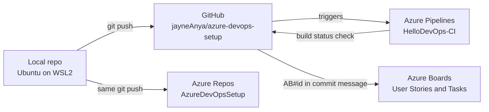

- One `git push` sends every commit to **both GitHub and Azure Repos**, so their histories are identical.
- **Azure Pipelines** builds from GitHub on every push to `main` and reports the result back as a check on the commit.
- **Azure Boards** is connected to GitHub, so a commit message containing `AB#<id>` links the commit to that work item, and `Fixes AB#<id>` closes it automatically.

---

## 1. Organization setup (Task 1)

The work is hosted in my existing organization, **`janeeanyanwu`** (see *Challenges* for why I didn't create a new one).

| Area | Configuration |
|---|---|
| Overview | Organization name, owner and region (Europe) |
| Users and access levels | Owner has **Basic** access. Evaluators can be invited from *Organization settings → Users*. |
| Policies | SSH authentication **On**. *Allow public projects* is not available to this organization (see *Challenges*). |
| Role-based access control | Owner is a member of **Project Collection Administrators**. Project-level access uses the default *Contributors* and *Readers* groups. |
| Parallel jobs | Free tier: **1 Microsoft-hosted parallel job, 1,800 minutes/month** for private projects |

| Overview | Users |
|---|---|
| 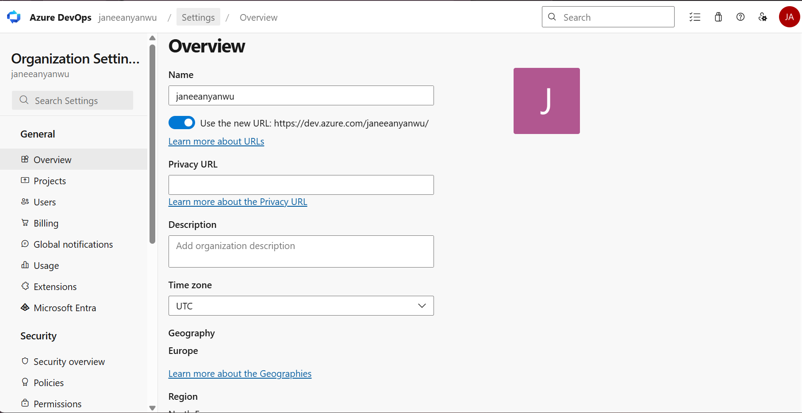 | 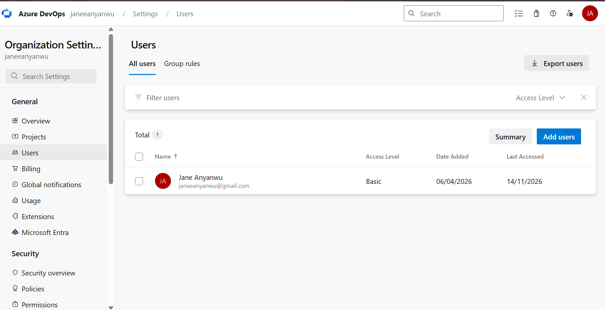 |

| Policies | Permissions |
|---|---|
| 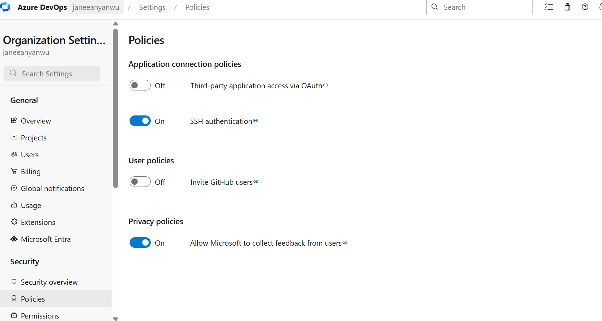 | 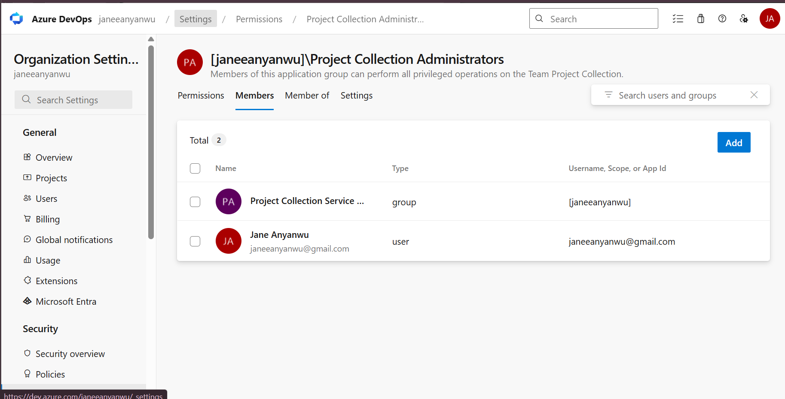 |

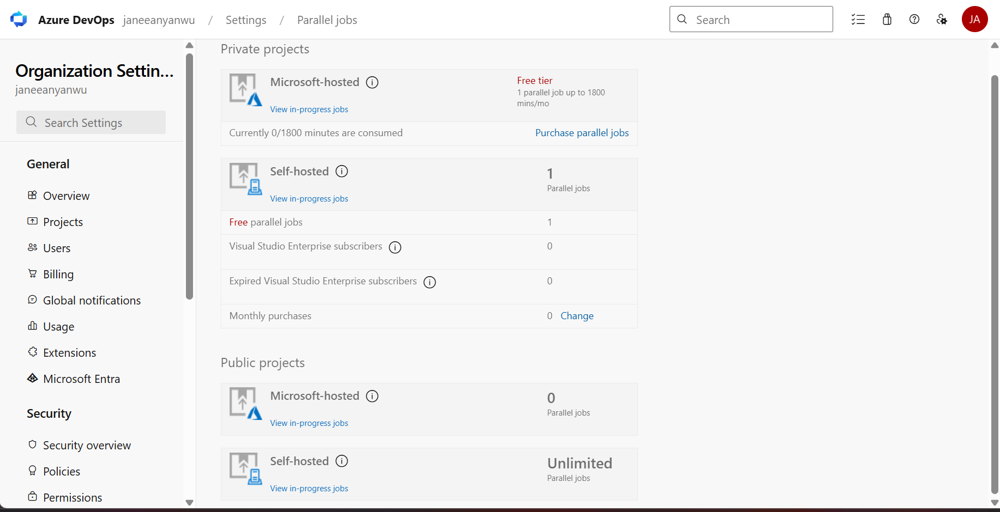

---

## 2. Project setup (Task 2)

| Setting | Value | Why |
|---|---|---|
| Name | `AzureDevOpsSetup` | Kept separate from my other project so this work is self-contained |
| Visibility | Private | Public projects are no longer available to this organization |
| Version control | Git | Industry standard; works with GitHub |
| Work item process | **Agile** | Provides *User Stories* and *Tasks* (the default *Basic* process only has *Issues*) |

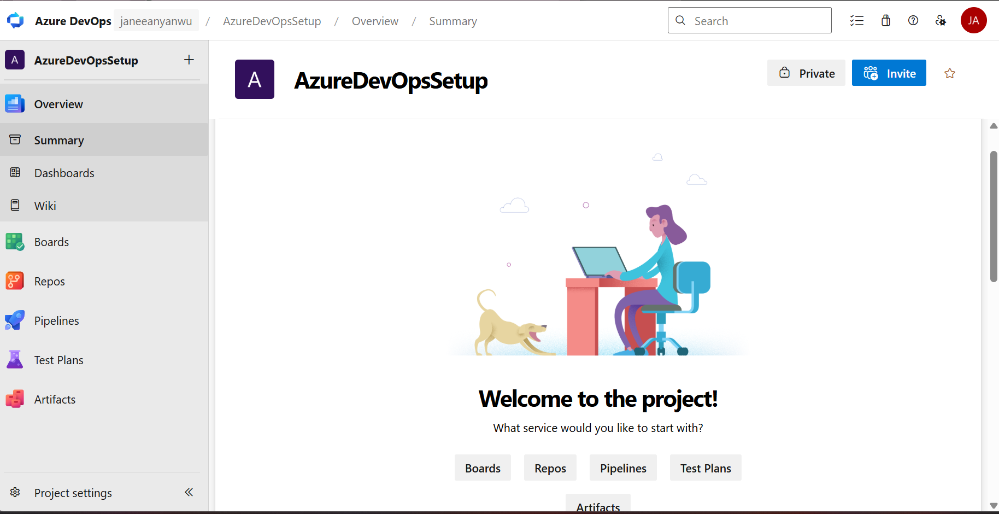

---

## 3. Azure Boards (Task 4)

The work was planned **before any code was written**: 3 User Stories broken into 8 Tasks. Each task maps to exactly one commit.

| ID | Type | Title | Closed by |
|---|---|---|---|
| 3 | User Story | Set up source control for the project | Tasks 4, 5 |
| 4 | Task | Add .gitignore and README | Commit `0bd0e48` |
| 5 | Task | Push code to GitHub and Azure Repos | First push to both remotes |
| 2 | User Story | Build a .NET 10 Web API with unit tests | Tasks 6, 7, 8 |
| 6 | Task | Scaffold .NET 10 Web API project | Commit `aa142bf` |
| 7 | Task | Add health and greeting endpoints | Commit `01ce1ba` |
| 8 | Task | Add xUnit test project | Commit `78048b9` |
| 1 | User Story | Build and test automatically with Azure Pipelines | Tasks 9, 10, 11 |
| 9 | Task | Add azure-pipelines.yml | Commit `95cb670` |
| 10 | Task | Create pipeline and get a successful run | Pipeline run `20261114.1` |
| 11 | Task | Connect Boards to GitHub and document setup | This README commit |

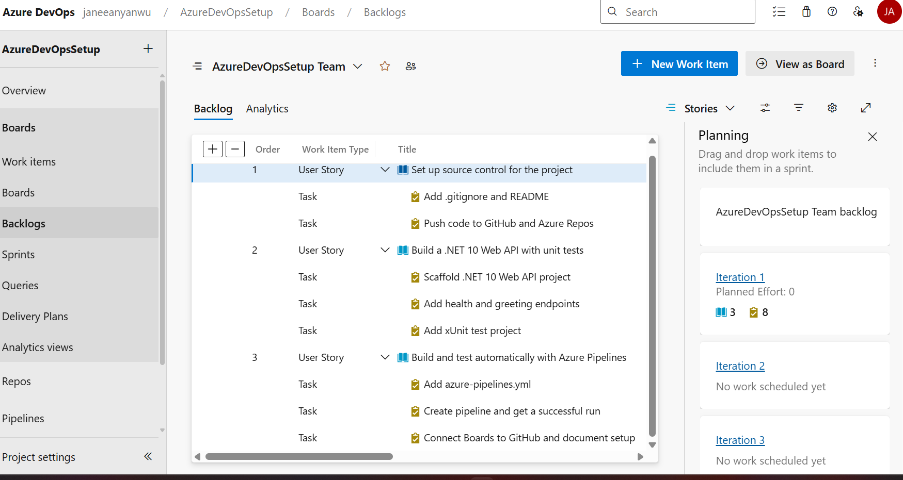
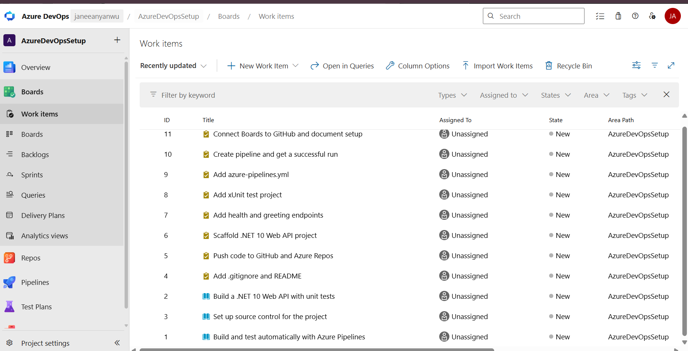

---

## 4. Repositories (Task 3)

### Two remotes, one push

The local repository pushes to GitHub (over SSH) and to Azure Repos (over HTTPS with a Personal Access Token) in a single command:

```bash
git remote add origin git@github.com:jayneAnya/azure-devops-setup.git
git remote add azure  https://janeeanyanwu@dev.azure.com/janeeanyanwu/AzureDevOpsSetup/_git/AzureDevOpsSetup

# make "git push" send to both
git remote set-url --add --push origin git@github.com:jayneAnya/azure-devops-setup.git
git remote set-url --add --push origin https://janeeanyanwu@dev.azure.com/janeeanyanwu/AzureDevOpsSetup/_git/AzureDevOpsSetup
```

### Project structure

```
azure-devops-setup/
├── AzureDevOpsSetup.slnx                 # solution file (.NET 10 format)
├── azure-pipelines.yml                   # CI pipeline definition
├── README.md
├── docs/screenshots/                     # evidence for this report
├── src/
│   └── HelloDevOps.Api/
│       ├── Program.cs                    # /health and /greet/{name} endpoints
│       └── Services/GreetingService.cs   # business logic (unit-tested)
└── tests/
    └── HelloDevOps.Api.Tests/
        └── GreetingServiceTests.cs       # 5 xUnit tests
```

### Commit history

Each commit is small, does one thing, and references its work item:

| Commit | Message | Work item |
|---|---|---|
| `0bd0e48` | Add .gitignore and README | AB#4 |
| `aa142bf` | Scaffold .NET 10 Web API project | AB#6 |
| `01ce1ba` | Add health and greeting endpoints | AB#7 |
| `78048b9` | Add xUnit test project for GreetingService | AB#8 |
| `95cb670` | Add Azure Pipelines CI configuration | AB#9 |
| *(latest)* | Add project documentation and screenshots | AB#11 |

| Azure Repos files | Azure Repos commits |
|---|---|
| 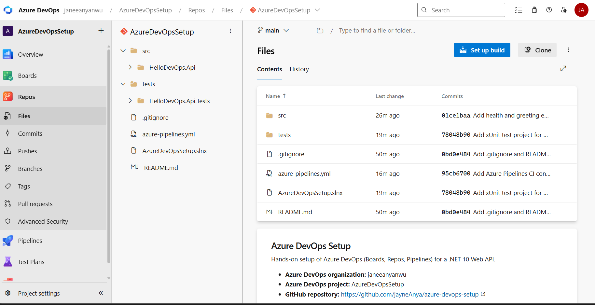 | 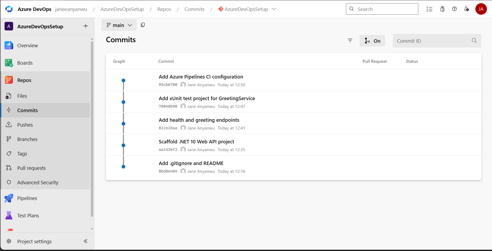 |

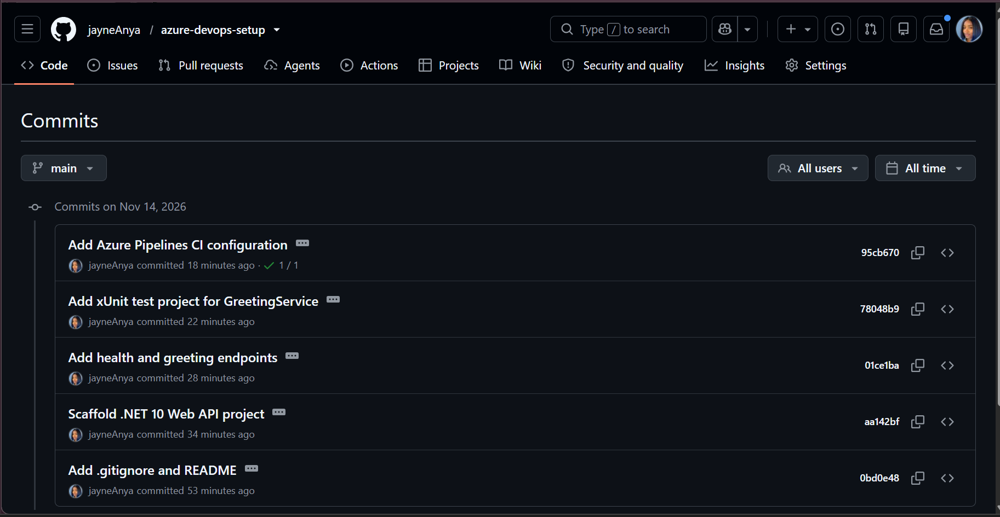

---

## 5. Azure Pipelines (Task 5)

`azure-pipelines.yml` defines the CI process:

| Setting / step | What it does |
|---|---|
| `trigger: main` | Runs on every push to `main` |
| `pr: main` | Also validates pull requests into `main` |
| `pool: ubuntu-latest` | Microsoft-hosted Linux agent |
| Install .NET SDK 10.x | Pins the SDK version the code is written for |
| Restore, then Build (Release) | Compiles the whole solution |
| Run unit tests | Runs xUnit, publishes results to the *Tests* tab, collects code coverage |
| Publish API | Produces deployable output |
| Upload build artifact | Saves it as the `hello-devops-api` pipeline artifact |

**Result of the first run:** all steps passed in 40 seconds, 5 of 5 tests passed, 1 artifact produced.

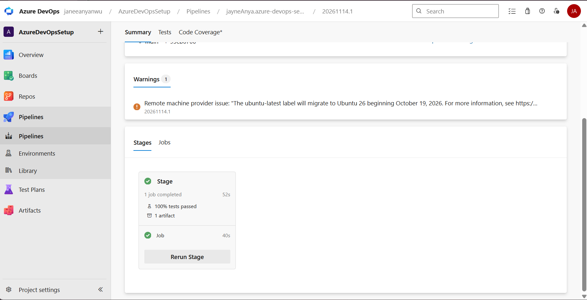

| Tests | Steps |
|---|---|
| 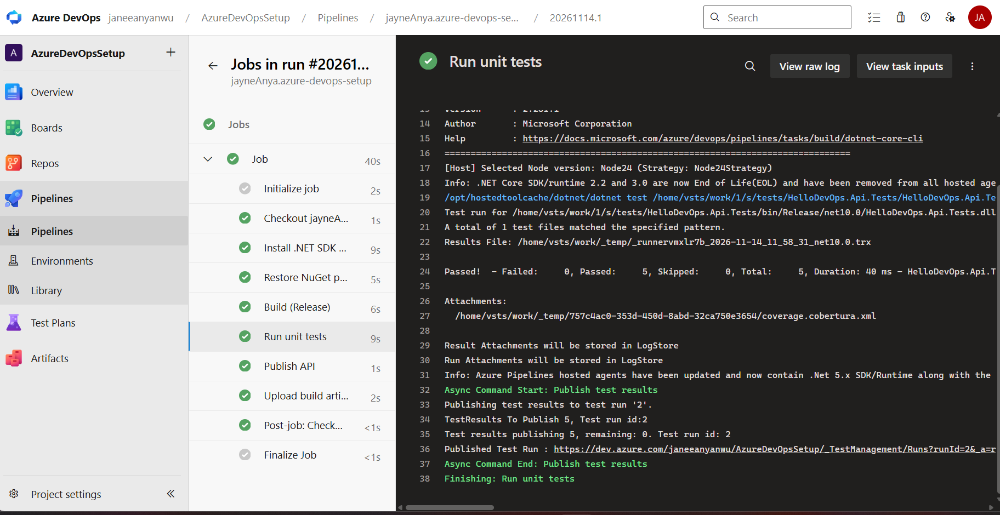 | 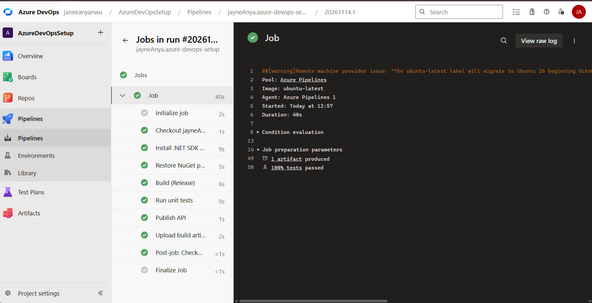 |

---

## 6. Integration and traceability (Task 6)

| Link | How it's set up | Evidence |
|---|---|---|
| Boards ↔ GitHub | *Project settings → GitHub connections*, using the Azure Boards GitHub App, limited to this one repository | Screenshot 09 |
| Commit → Work item | `AB#<id>` in the commit message; `Fixes AB#<id>` also closes the item | Screenshot 16 |
| Pipelines ↔ GitHub | Azure Pipelines GitHub App, limited to this one repository; build status appears on each commit | Screenshot 15 |
| Repos ↔ GitHub | Dual push URL, so both remotes always hold the same history | Screenshots 13–15 |

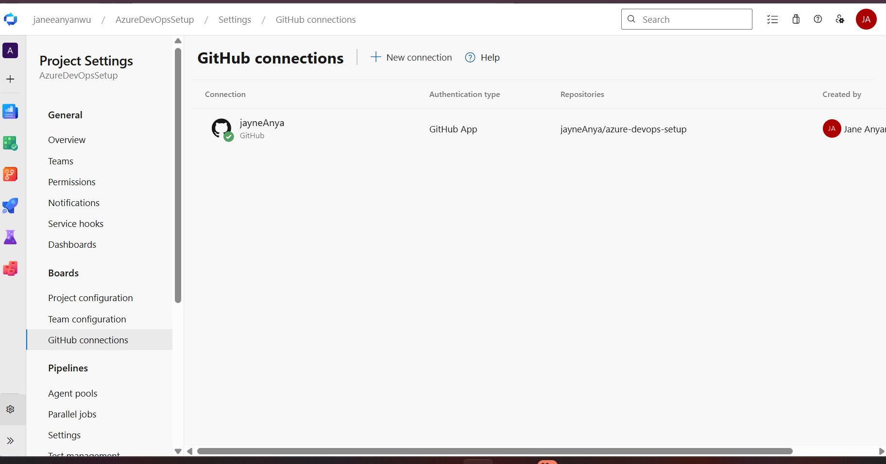
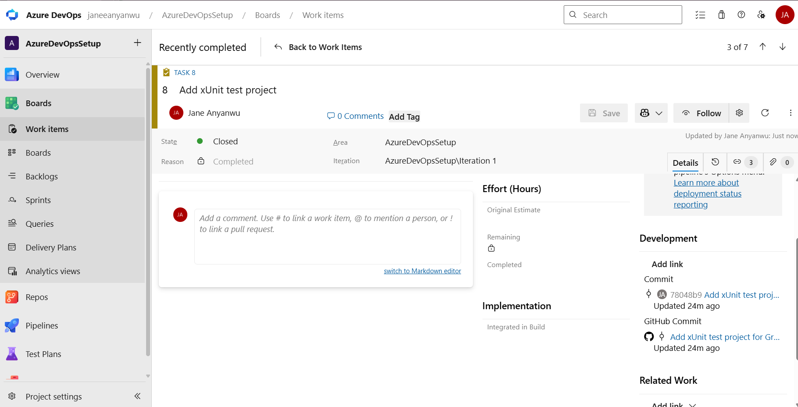

---

## Run it locally

Requires the .NET 10 SDK.

```bash
dotnet build
dotnet test
dotnet run --project src/HelloDevOps.Api --urls http://localhost:5080

curl http://localhost:5080/health        # {"status":"Healthy",...}
curl http://localhost:5080/greet/Jane    # {"message":"Hello, Jane! Welcome to Azure DevOps."}
```

---

## Challenges encountered

1. **New organizations require an Azure subscription.** Azure DevOps now requires every new organization to be linked to an active, paid Azure subscription. I already had the `janeeanyanwu` organization, so I reused it and configured it for this project instead of adding a payment card.
2. **Public projects are no longer available.** The *Allow public projects* policy was missing from *Organization settings → Policies*. Microsoft has withdrawn it for organizations that weren't already using it, and recommends GitHub for public work. I kept the Azure DevOps project **Private**, made the **GitHub repository public**, and documented the Azure DevOps side with screenshots. Evaluators who need live access can be invited by email.
3. **Git authentication from WSL.** Git Credential Manager isn't installed in my Ubuntu (WSL2) environment. GitHub uses my existing SSH key. Azure Repos uses a Personal Access Token scoped to *Code: Read & write* with a 30-day expiry, cached in memory by `git credential-cache`. My first push to Azure failed authentication because the token was pasted incorrectly; it worked on the second attempt.
4. **Order of integration steps.** `AB#` links are only created for commits pushed *after* Boards is connected to GitHub. I connected Boards to GitHub before the first push so every commit is linked.
5. **Choosing the .NET version.** .NET 8 reached end of support in November 2026, so the project targets **.NET 10** (current LTS). The .NET 10 SDK creates solutions in the newer `.slnx` format, which the pipeline restores and builds directly.
6. **Hosted agent image change.** The pipeline log warns that `ubuntu-latest` will move to Ubuntu 26. The build doesn't depend on OS-specific tools, so no change is needed now; pinning `vmImage: ubuntu-24.04` is the fallback if the migration causes problems.
7. **UI differences from the documentation.** *Column Options* wasn't where expected on the Backlog page, so I used *Boards → Work items*, which shows work item IDs by default.

---

## Access verification

- **GitHub repository:** public, no sign-in needed: https://github.com/jayneAnya/azure-devops-setup
- **Azure DevOps project:** private. Evaluators can be invited via *Organization settings → Users → Add users* (Basic or Stakeholder access), with access to the `AzureDevOpsSetup` project.
